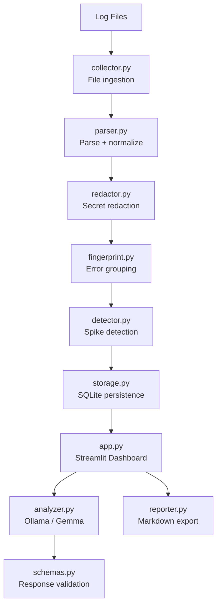

# 🦥 LogSloth — Lazy Developer's Error Detective

> **You relax. We read the logs.**

LogSloth is a local-first AI log-triage tool that automatically parses, groups, and explains your application errors — powered by a locally running Gemma model via Ollama.

Built for [Hacktoberfest 2026](https://hacktoberfest.com) — **Slow and Steady** challenge.

---

## 🚨 The Problem

Application logs are noisy. A single bug can generate thousands of nearly-identical error lines. Finding the signal in that noise is tedious, manual, and slow. Most log tools send your data to the cloud.

## ✅ The Solution

LogSloth runs **entirely on your machine**:
1. Reads your log files
2. Parses and normalises entries (including multiline stack traces)
3. Redacts secrets before anything is analysed
4. Groups repeated errors into incidents using deterministic fingerprints
5. Detects error spikes automatically
6. Uses a **local** Gemma model (via Ollama) to generate evidence-backed summaries
7. Shows everything in a polished Streamlit dashboard
8. Persists incident metadata in SQLite
9. Exports sanitised Markdown reports

No cloud. No API keys. No data leaves your machine.

---

## ✨ Features

| Feature | Status |
|---|---|
| Multi-format log parsing | ✅ |
| Multiline Python stack trace support | ✅ |
| Automatic secret redaction (tokens, passwords, JWTs, AWS keys) | ✅ |
| Deterministic error fingerprinting | ✅ |
| Occurrence counting + deduplication | ✅ |
| Error spike detection | ✅ |
| Local AI analysis (Ollama / Gemma) | ✅ |
| Graceful degradation when AI unavailable | ✅ |
| Streamlit dashboard (dark mode, glassmorphism) | ✅ |
| SQLite persistence | ✅ |
| Markdown report export | ✅ |
| Synthetic demo dataset | ✅ |
| Full unit + E2E test suite | ✅ |

---

## 🏗️ Architecture



---

## 🛠️ Tech Stack

| Component | Technology |
|---|---|
| UI | Streamlit |
| AI inference | Ollama (local HTTP API) |
| AI model | Gemma (configurable) |
| Storage | SQLite |
| Language | Python 3.11+ |
| HTTP | requests |
| Testing | pytest, pytest-mock |
| Config | python-dotenv |
| File watching | Watchdog |

---

## 📋 Prerequisites

- **Windows 10/11** (or macOS/Linux)
- **Python 3.11+**
- **Ollama** (optional — required only for AI analysis)
- 4 GB RAM minimum; 8 GB recommended for local AI

---

## 🚀 Installation (Windows / PowerShell)

### 1. Clone the repository

```powershell
git clone https://github.com/yashr5120/LogSloth
cd logsloth
```

### 2. Create and activate a virtual environment

```powershell
python -m venv .venv
.\.venv\Scripts\Activate.ps1
```

> If you see an execution policy error:
> ```powershell
> Set-ExecutionPolicy -ExecutionPolicy RemoteSigned -Scope CurrentUser
> ```

### 3. Install dependencies

```powershell
pip install -r requirements.txt
```

### 4. Copy the example environment file

```powershell
Copy-Item .env.example .env
```

Edit `.env` to match your setup (optional — defaults work for the demo).

---

## 🤖 Ollama Setup (optional — for AI analysis)

### Install Ollama

Download from [https://ollama.com/download](https://ollama.com/download) and install.

### Pull a model

```powershell
ollama pull gemma3:1b
```

> **Configuring a different model:** Set `OLLAMA_MODEL=<model-name>` in your `.env` file.
> Available models: `gemma3:1b`, `gemma3:4b`, `llama3.2:3b`, etc.

### Start Ollama (if not already running)

```powershell
ollama serve
```

---

## ▶️ Launching LogSloth

```powershell
streamlit run app.py
```

The dashboard will open at `http://localhost:8501`.

---

## 🎬 Demo Workflow

### Generate the synthetic demo dataset

```powershell
python scripts/generate_demo_logs.py
```

### Load and analyse

1. Open the dashboard at `http://localhost:8501`
2. Click **🔄 Analyse Logs** in the sidebar
3. Explore the **📊 Overview** tab — see error rate timeline and top incidents
4. Switch to **🔍 Incidents** — filter by severity, search, sort
5. Click **View →** on any incident for full details
6. Click **▶ Analyse** to run local AI diagnostics (requires Ollama)
7. Click **⬇ Download Markdown Report** to export

---

## 🧪 Tests

```powershell
pytest tests/ -v
```

Tests cover:
- Timestamp and line parsing
- Multiline stack trace assembly
- Malformed record handling
- Secret redaction (parametrised)
- Fingerprint stability and separation
- Occurrence counting
- Spike detection edge cases (no timestamps, insufficient baseline, empty data)
- SQLite persistence and duplicate prevention
- AI response validation
- Ollama unavailable / timeout / malformed JSON (mocked)
- Full end-to-end pipeline with mocked AI

> All tests run **without** downloading a model or making network calls.

---

## 🔒 Privacy & Security Design

| Concern | How LogSloth handles it |
|---|---|
| Log data uploaded to cloud | **Never.** All processing is local. |
| Secrets in AI prompts | Redacted before evidence is built |
| AI-generated shell commands | Never executed — treated as untrusted text |
| Arbitrary directory scanning | Never. Paths are explicitly configured. |
| Local service binding | Streamlit binds to localhost by default |
| Model output trust | Treated as untrusted; never eval'd or exec'd |

**Redaction limitation:** LogSloth uses regex patterns to detect common secret formats (Bearer tokens, API keys, passwords, JWTs, AWS keys, URL credentials). Custom or obfuscated secrets may bypass detection. This feature reduces risk but does not guarantee complete secret removal.

---

## 📴 Offline Operation

LogSloth's deterministic core (parsing, grouping, counting, spike detection, SQLite, report export) works **fully offline** with no internet connection.

AI analysis requires a locally running Ollama server. When Ollama is unavailable:
- A clear status indicator is shown in the sidebar
- All deterministic features continue to work
- The AI analysis button shows a descriptive error
- No data is lost

---

## ⚖️ Evaluation Methodology

LogSloth can be evaluated against the synthetic demo logs:
1. Run `python scripts/generate_demo_logs.py` — generates reproducible logs
2. Run `streamlit run app.py` and click **Analyse Logs**
3. Verify the incident list matches the documented expected groupings in `scripts/generate_demo_logs.py`
4. Run `pytest tests/ -v` to verify all unit and E2E tests pass

---

## ⚠️ Known Limitations

- **Redaction is regex-based** — not ML-based; custom secret formats may slip through
- **AI model quality varies** — smaller models (1b) produce less nuanced analysis
- **No live log streaming UI** — the file tailer runs in a background thread but Streamlit requires a manual reload to surface new events
- **SQLite is single-writer** — not suitable for multi-process concurrent writes
- **Python 3.14 compatibility** — developed on Python 3.14; some dependencies may show deprecation warnings

---

## 🗺️ Roadmap

- [ ] Live log streaming with Streamlit auto-refresh
- [ ] Multi-file diff view (compare incident patterns across deployments)
- [ ] Structured log (JSON) format support
- [ ] Alert webhooks (Slack, email)
- [ ] Plugin system for custom redaction patterns
- [ ] Dark / light theme toggle

---

## 📸 Screenshots

_Screenshots can be taken after launching `streamlit run app.py` and loading the demo logs._

---

## 🏆 Hacktoberfest 2026 — Slow and Steady

LogSloth is submitted to the **Slow and Steady** challenge: a thoughtfully-built, local-first developer tool that prioritises correctness, privacy, and developer experience over complexity.

**Why it qualifies:**
- Meaningful open-source contribution with a real use case
- Privacy-first architecture (no cloud, no external APIs required)
- Comprehensive test coverage
- Detailed documentation and reproducible demo

---

## 📄 Licenses

| Dependency | License |
|---|---|
| Streamlit | Apache 2.0 |
| Ollama | MIT |
| Gemma models | [Gemma Terms of Use](https://ai.google.dev/gemma/terms) |
| requests | Apache 2.0 |
| pytest | MIT |
| python-dotenv | BSD |
| watchdog | Apache 2.0 |

LogSloth itself is released under the **MIT License**.
